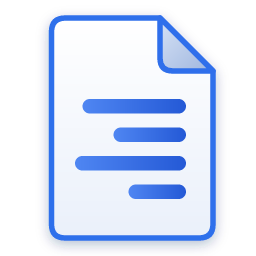

<p align="center">
  
</p>

<h1 align="center">Daf</h1>

<p align="center">
  A fast, lightweight text editor that never loses your tabs, handles every encoding,
  and gets right-to-left text right.<br>
  <b>Free and open source · No telemetry · Windows</b>
</p>

<p align="center">
  <a href="https://github.com/Felixumansky/daf-editor/releases/latest"><b>⬇ Download for Windows</b></a>
</p>

*Daf* means "page" in Hebrew.

## Install

1. Download `Daf_x.y.z_x64-setup.exe` from the [latest release](https://github.com/Felixumansky/daf-editor/releases/latest).
2. Run it. The installer needs no administrator rights and finishes in seconds. It installs for your user only and adds Daf to the Start menu and to **Open with** for text files.
3. On first start, Daf asks whether to open automatically when you sign in. If you say yes, it comes back with the same tabs you had open, including unsaved ones.

> **Windows SmartScreen:** early builds are not code-signed yet, so Windows may show "Windows protected your PC".
> Click **More info → Run anyway**. Signed releases are planned (see the roadmap).

To uninstall, use **Settings → Apps → Installed apps → Daf**. Your settings and session stay in `%APPDATA%\dev.daf.editor` and `%LOCALAPPDATA%\dev.daf.editor` until you delete them.

## Features

- **Tabs that are never lost.** You can close Daf, or even kill it, with unsaved and untitled tabs. Everything comes back next time. Unsaved text is mirrored to disk within 2 seconds of typing.
- **Opens with Windows.** Optionally, Daf starts when you sign in and reopens your last session. Turn it on or off with *File → Open Daf When I Sign In*.
- **Real encoding support.**
  - Detects BOMs, UTF-8, UTF-16 LE/BE, and legacy code pages such as Windows-1255 (Hebrew), Windows-1252 and Windows-1251.
  - Opening and saving an unedited file is byte-for-byte identical.
  - *Reopen with encoding* and *Convert to encoding* are built in. If a character can't be saved, Daf tells you where it is.
- **Line endings.** CRLF, LF and CR are detected and preserved. Mixed endings are flagged, and you can convert in one click.
- **Right-to-left done properly.**
  - Each line takes its direction from its own text, so Hebrew and Arabic lines flow right-to-left next to English lines.
  - RTL comments and strings inside code are isolated, so `// הערה` keeps `//` on the left.
  - Invisible bidi control characters are highlighted, which protects against [Trojan Source](https://trojansource.codes/) attacks.
- **Command palette** (`Ctrl+Shift+P` or `F1`) with fuzzy search over every command.
- **Notepad++ shortcuts** by default (`Ctrl+D` duplicate line, `Ctrl+Shift+L` delete line, `Ctrl+Q` comment, …). An optional VS Code preset is included. Shortcuts keep working with any keyboard layout active.
- **Safe saving.**
  - Writes are atomic and keep file permissions.
  - Saving through symlinks updates the real file.
  - If another program changed the file, Daf asks before overwriting it.
- **Single window.** `daf file.txt:120:5` opens the file in the running window at line 120, column 5. Drag-and-drop works too.
- Syntax highlighting for about 25 languages, plus multiple cursors, column selection, folding, go to line, zoom, word wrap, and light/dark themes that follow Windows.
- English interface, with an optional Hebrew interface (*View → Interface Language*).

## Keyboard shortcuts (Notepad++ preset)

| Action | Keys |
| --- | --- |
| Command palette | `Ctrl+Shift+P` or `F1` |
| New / Open / Save / Save As | `Ctrl+N` / `Ctrl+O` / `Ctrl+S` / `Ctrl+Alt+S` |
| Close tab / Reopen closed tab | `Ctrl+W` / `Ctrl+Shift+T` |
| Find / Replace / Next / Previous | `Ctrl+F` / `Ctrl+H` / `F3` / `Shift+F3` |
| Go to line | `Ctrl+G` |
| Duplicate / Delete / Move line | `Ctrl+D` / `Ctrl+Shift+L` / `Ctrl+Shift+↑↓` |
| Toggle comment | `Ctrl+Q` |
| Right-to-left / Left-to-right | `Ctrl+Alt+R` / `Ctrl+Alt+L` |
| Zoom | `Ctrl+=` / `Ctrl+-` / `Ctrl+0`, or `Ctrl+mouse wheel` |
| Next / previous tab | `Ctrl+Tab` / `Ctrl+Shift+Tab` |

## Privacy and trust

- No telemetry and no network access. Daf never phones home.
- The UI runs under a strict Content Security Policy and has no general file-system access. It can only touch files you opened.
- AI features (planned) are off by default and will support local models.

## Build from source

You need:
- [Rust](https://rustup.rs) 1.99 (pinned in `rust-toolchain.toml`).
- [Node.js](https://nodejs.org) 24.
- On Windows, the MSVC build tools and the Windows 11 SDK.

```sh
npm install
npm run tauri dev      # run in development mode
npm run tauri build    # build the installer -> target/release/bundle/nsis/
npm test               # TypeScript unit tests
cargo test --workspace # Rust tests (encoding corpus, atomic save, session)
npm run check          # type check
```

`samples/` contains files for trying Daf out: a Windows-1255 file with CRLF line endings, a JavaScript file with right-to-left comments and hidden bidi characters, and mixed-direction Markdown.

### Project layout

| Path | What |
| --- | --- |
| `crates/daf-core` | Pure Rust core, independent of Tauri: encodings, line endings, atomic save, session, settings. Tested headless. |
| `src-tauri` | Tauri shell: IPC commands, path permissions, single instance, start at sign-in. |
| `src/lib/state` | Workspace: tabs, one editor view with a separate state per tab, session persistence. |
| `src/lib/commands` | Command registry, key presets, built-in commands, quick pickers. |
| `src/lib/editor` | CodeMirror 6 setup, theme, languages, right-to-left support (`rtl/`). |

## Roadmap

| Phase | Content | Done when |
| --- | --- | --- |
| 0 · Skeleton | Tabs and saving, highlighting, tabs never lost | It is someone's daily editor ✅ |
| 1 · Real editor | Palette, folder search, full RTL test suite, file associations | It replaces an existing editor (in progress) |
| 2 · Big files | 10 GB logs, CSV/JSON/log views, local file history | A 10 GB file opens in one second |
| 3 · AI | Any agent via the Agent Client Protocol, local models via Ollama, macros from plain language | Everything works offline |
| 4 · Release | Sandboxed WASM plugins, signed auto-updates | Signed, verified releases |

## Contributing

Issues and pull requests are welcome. Please run `npm test`, `cargo test --workspace` and `npm run check` before opening a PR.

## License

[Mozilla Public License 2.0](LICENSE). The name and logo are covered by [TRADEMARKS.md](TRADEMARKS.md).
Daf is an independent project. It is not affiliated with Notepad++ and contains no Notepad++ code.
